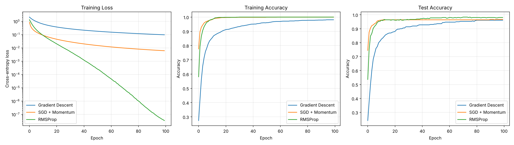

# Assignment 8051: Momentum and RMSProp Optimizers

Comparison of **plain Gradient Descent**, **SGD with Momentum** and **RMSProp**
on the same neural network task.

## Task
- Dataset: scikit-learn Digits (1797 images of 8x8 pixels, 10 classes), 80/20 train/test split
- Model: 2-layer MLP (64 -> 64 ReLU -> 10 Softmax), implemented from scratch in NumPy
- Loss: Cross-entropy; mini-batch size 64; 100 epochs
- All optimizers use identical initial weights and identical batch order, so the comparison is fair

## Optimizer update rules
| Optimizer | Update | Hyperparameters |
|---|---|---|
| Gradient Descent | `w = w - lr * g` | lr = 0.01 |
| SGD + Momentum | `v = beta*v + g;  w = w - lr * v` | lr = 0.01, beta = 0.9 |
| RMSProp | `s = rho*s + (1-rho)*g^2;  w = w - lr * g / (sqrt(s)+eps)` | lr = 0.001, rho = 0.9 |

## How to run
```bash
pip install -r requirements.txt
python optimizers_comparison.py
```
Outputs: `loss_curves.png` and `results.txt`.

## Results
| Optimizer | Final loss | Train acc | Test acc | Epochs to loss <= 0.1 |
|---|---|---|---|---|
| Gradient Descent | 0.0977 | 0.9812 | 0.9611 | 98 |
| SGD + Momentum | 0.0062 | 1.0000 | 0.9667 | 10 |
| RMSProp | 0.0000 | 1.0000 | 0.9806 | 11 |



## Observations
- **Convergence speed:** Momentum and RMSProp reach a loss of 0.1 in about 10 epochs, while plain gradient descent needs about 98. Momentum accumulates velocity along consistent gradient directions; RMSProp scales each step by a running average of squared gradients.
- **Loss curves:** Gradient descent decreases slowly and smoothly. Momentum drops fast. RMSProp drops fastest and reaches near-zero training loss.
- **Final accuracy:** RMSProp gave the best test accuracy (98.1%), followed by Momentum (96.7%) and Gradient Descent (96.1%).
- **Caveat:** RMSProp and Momentum reach ~100% training accuracy, which suggests some overfitting on this small dataset. Results depend on the learning rates used and on a single run/seed.
